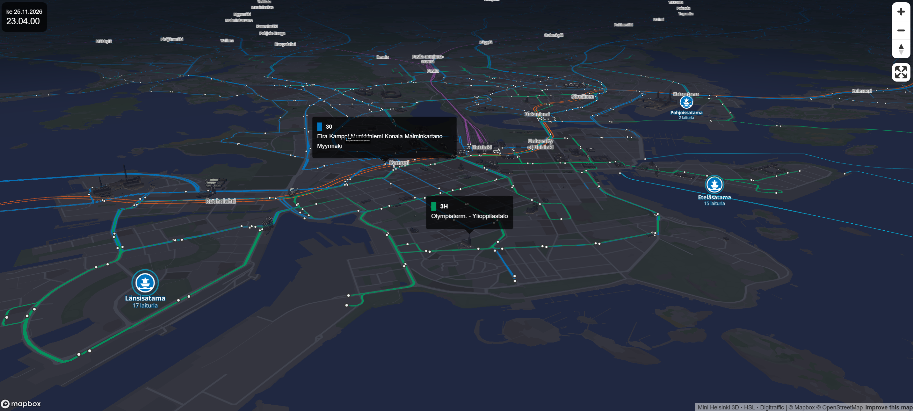

# Mini Helsinki 3D, fork of Mini Tokyo 3D

A real-time 3D digital map of Helsinki's public transport system.



## Demo Videos

Upcoming

## User Guides

- [User Guide (English)](https://minitokyo3d.com/docs/master/)

## Developer Guides

- [Developer Guide (English)](https://minitokyo3d.com/docs/master/developer-guide/)

## Cheat Sheet

Operation | Description
--- | ---
Mouse or finger drag | Pan
Mouse wheel rotation | Zoom in/out
Right click or Ctrl key + mouse drag | Tilt up/down and rotate
Shift key + mouse drag | Box zoom
Pinch in/out | Zoom in/out
Two-finger drag | Tilt up/down and rotate
Double-click or triple-tap | Zoom in
Shift key + Double-click or two-finger tap | Zoom out
Click or tap the search button | Show/hide the route search panel
Click or tap +/- buttons | Zoom in/out
Click or tap the compass button | Reset bearing to north
Click or tap the compass button + mouse or finder drag | Rotate
Click or tap the fullscreen button | Toggle the fullscreen mode
Click or tap the eye button | Toggle the underground mode
Click or tap the playback button | Toggle the playback mode
Click or tap the battery button | Toggle the eco mode
Click or tap the layer button | Show/hide the layer display settings panel
Click or tap the camera button | Show/hide the tracking mode settings panel
Click or tap the info button | Show/hide the app info panel
Click or tap a train/aircraft/station | Enable tracking or select station
Click or tap the map | Disable tracking or deselect station
Hover a train/aircraft/station | Show the train/aircraft/station information

## Language Support

Currently, the following languages are supported. Any help or contribution with translations and additional language support is always greatly appreciated.

Language | User Interface | Map Labels | Stations, Railways, Airlines, etc. | User Guide
--- | --- | --- | --- | ---
English | Yes | Yes | Yes | Yes
Japanese | Yes | Yes | Yes | Yes
French | Yes | Yes | Yes | Yes
Chinese (Simplified) | Yes | Yes | Yes | Yes
Chinese (Traditional) | Yes | Yes | Yes | -
Korean | Yes | Yes | Yes | -
Thai | Yes | - | - | -
Nepali | Yes | - | - | -
Portuguese (Brazil) | Yes | - | - | -
Spanish | Yes | - | - | -
German | Yes | - | - | -
Finnish | Yes | - | - | -

If you want to contribute, please start with translating the UI messages in the `dictionary-<ISO 639-1 code>.json` file in the [`data`](https://github.com/nagix/mini-tokyo-3d/tree/master/data) directory. Then, if you have extra energy, add the title of each item in your language to [`airports.json`](https://github.com/nagix/mini-tokyo-3d/blob/master/data/airports.json), [`flight-statuses.json`](https://github.com/nagix/mini-tokyo-3d/blob/master/data/flight-statuses.json), [`operators.json`](https://github.com/nagix/mini-tokyo-3d/blob/master/data/operators.json), [`poi.json`](https://github.com/nagix/mini-tokyo-3d/blob/master/data/poi.json), [`rail-directions.json`](https://github.com/nagix/mini-tokyo-3d/blob/master/data/rail-directions.json), [`railways.json`](https://github.com/nagix/mini-tokyo-3d/blob/master/data/railways.json), [`stations.json`](https://github.com/nagix/mini-tokyo-3d/blob/master/data/stations.json), [`train-types.json`](https://github.com/nagix/mini-tokyo-3d/blob/master/data/train-types.json) in the [`data`](https://github.com/nagix/mini-tokyo-3d/tree/master/data) directory.


## Mini Helsinki 3D profile

This fork includes an optional Helsinki profile that renders static HSL route geometry and Digitraffic maritime ports without loading the Tokyo static or realtime datasets.

The data for this visualization are sourced from HSL (Helsinki Region Transport, https://www.hsl.fi/en/hsl/open-data) and Fintraffic (Finnish national transit data, https://www.fintraffic.fi/en/digitalservices/data-services). Station information and timetables are not yet implemented.

Place the extracted HSL GTFS files in `helsinki/hsl`, then generate the compact
route and stop dataset:

```bash
npm run build-helsinki-data
```

Set `MT3D_PROFILE=helsinki` in `.env` (and provide `MAPBOX_ACCESS_TOKEN`), then
start development mode:

```bash
npm run dev
```

For a production build, run:

```bash
npm run build
npm run build-helsinki-data
MT3D_PROFILE=helsinki npm run build-pages
```

On Windows PowerShell, set the profile for the page-build process with
`$env:MT3D_PROFILE = "helsinki"` before running `npm run build-pages`. The
generated page and `build/data/hsl-routes.json` must be deployed together. The
dataset contains route geometry and stop points but intentionally excludes
`stop_times.txt` and schedules.

`npm run build-helsinki-data` also requests
`/api/port-call/v2/ports/FIHEL` from Digitraffic and writes
`build/data/helsinki-ports.json`. Deploy this file beside the HSL dataset. Port
areas without coordinates are omitted. The map shows a summary halo around
each port area and lists its active berths when the ship symbol is clicked;
Digitraffic does not provide berth-footprint polygons, so the halos are not
official berth boundaries. Ship symbols and halos fade in progressively: large
ports from zoom 10.5, medium ports from 11.5, smaller ports from 12.5, and areas
without active berths from 13.5.

## How to Build

First, get access token for [Mapbox](https://account.mapbox.com/auth/signup/).

The latest version of Node.js is required. Move to the root directory of the application and install the dependencies.
```bash
npm install
```

Provide the access tokens through environment variables and run the build. The script, dataset and static web page will be generated in the `build` directory.
```bash
MAPBOX_ACCESS_TOKEN=<Mapbox access token> \
npm run build-all
```

Finally, place all the files in the `build` directory on your web server.

See the [Developer Guides](#developer-guides) for more details.

## License

Mini Helsinki 3D is fork of Mini Tokyo 3D, which is available under the [MIT license](https://opensource.org/licenses/MIT).
